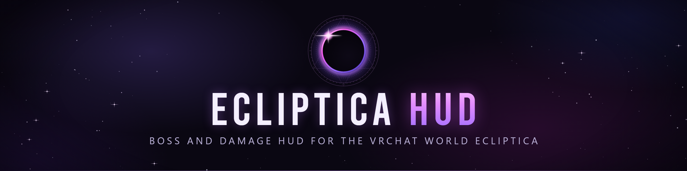

> [!NOTE]
> **Oct 22, 2026:** Ecliptica had a big update and we're still catching the HUD up to it.

  

  
  
  
  
  

  <a href="https://github.com/RealWhyKnot/EclipticaHUD/releases/latest">Download</a> ·
  <a href="https://github.com/RealWhyKnot/EclipticaHUD/issues">Report a bug</a>

EclipticaHUD reads your VRChat log and shows the boss, who it's targeting, your damage and your runs in Ecliptica. It opens as a desktop panel and as a SteamVR overlay on your left controller.

## Shared damage

Open the party window (the button next to settings) and turn sharing on to see the boss damage dealt and taken by everyone in your instance who also shares. It's off by default.

During a boss fight the HUD sends your damage dealt and taken to `ecliptica.whyknot.dev` at most once a second, along with hashes of the instance and your VRChat user ID. Names come from each player's own log, and the server keeps nothing on disk.

## Sharing fight data

The HUD asks once whether you want to share fight data, and it stays off unless you say yes. You can change your answer later with the Share fight data switch in settings. With it on, the HUD sends the Ecliptica lines it reads from your log to `ecliptica.whyknot.dev` about every ten minutes, to help us improve the HUD. That includes boss and enemy names, stages, the damage you dealt and took and what hit you, the player count, the world ID and instance number, and the HUD version. It also sends the run, fight and stage totals the HUD works out from those lines. In other worlds it only notes that you left Ecliptica. Saved shared fights go too, as numbers with no names attached.

Player names and user IDs are taken out on your PC before anything is sent. Other players show up as P1, P2 and so on, and you show up as "you". The numbering starts over for each log file and for each saved fight. The instance keeps its number but loses the owner and region tags, and a named instance is sent as a hash instead of its name. Each upload starts with the date, the clock time of its first line and your UTC offset; after that, each line only keeps how long after the previous one it came. Each log file gets an ID made from its name and a random key that stays on your PC, so the server can join uploads from the same session. Nothing from before you turned the switch on is sent. The server keeps the uploads as files.

## Leaderboard

Turn on Leaderboard in settings to put your boss kill times on [ecliptica.whyknot.dev](https://ecliptica.whyknot.dev) under your VRChat display name. It's off by default. While it's on, the HUD sends your fight data and VRChat name. New kills show as pending while we check them, and only kills made with Leaderboard on count.

Each entry has the kill time, how many players were in the instance, your class, the stage, damage dealt and taken, hits taken, the biggest hit you took, deaths and graphs of damage dealt and taken over the fight.

The first time, the HUD makes a random key in `%APPDATA%\EclipticaHUD\board-key.txt`. That key owns your name on the board, so another PC can't post under it. Turning Leaderboard off stops sending new kills. To remove the ones already on the board, click Delete next to BOARD KILLS in settings.

## History

The HUD copies the Ecliptica lines it uses from your VRChat log into `%APPDATA%\EclipticaHUD\history.db`, so your runs stay in the panel after VRChat deletes its old logs. Shared fights get saved there when they end, and the arrows at the bottom of the party window page back through them. The file stays on your PC.

## Install

Download `ecliptica-hud-<version>.exe` from the [latest release](https://github.com/RealWhyKnot/EclipticaHUD/releases/latest) and run it. It checks for a new version when it starts, and you can update from the panel.

## Build

You need MSVC, CMake and LLVM. Then run `cargo build --release`.

## License

GPL-3.0-or-later. See [LICENSE](LICENSE).
