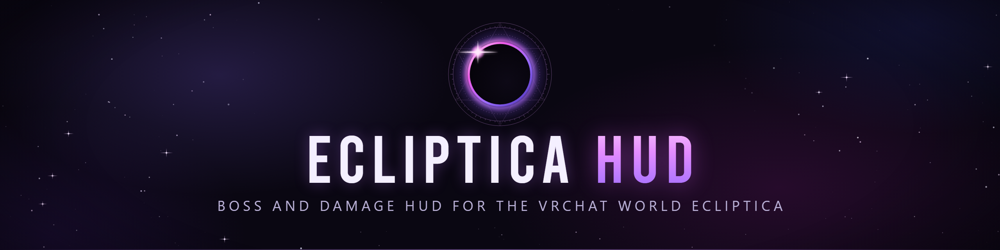

  

  
  
  
  
  

  <a href="https://github.com/RealWhyKnot/EclipticaHUD/releases/latest">Download</a> ·
  <a href="https://github.com/RealWhyKnot/EclipticaHUD/issues/new">Report a bug</a> ·
  <a href="docs/privacy.md">Privacy</a> ·
  <a href=".github/SECURITY.md">Security</a>

EclipticaHUD reads your VRChat log and shows the boss, who it's targeting, your damage and your runs in Ecliptica. It opens as a desktop panel and as a SteamVR overlay on your left controller.

## Data sharing

Three optional features send data to `ecliptica.whyknot.dev`. All are off until you turn them on. [docs/privacy.md](docs/privacy.md) has the full list.

- Shared damage (party window) sends your boss damage dealt and taken, hashes of the instance and your VRChat user ID, and your current run's stages and bosses, so everyone sharing in your instance sees each other's numbers. The server keeps nothing on disk.
- Share fight data (settings) asks once. When on, it uploads the Ecliptica lines from your log about every ten minutes, with player names and user IDs removed on your PC first. The server keeps these uploads as files.
- Leaderboard (settings) is covered below.

Nothing from before you turned a switch on is sent, and nothing outside Ecliptica. Turn a switch off and nothing new is sent. To remove kills already on the leaderboard, see below.

## Leaderboard

Turn on Leaderboard in settings to put your boss kill times on [ecliptica.whyknot.dev](https://ecliptica.whyknot.dev) under your VRChat display name. It's off by default. While it's on, the HUD sends your fight data and VRChat name. New kills show as pending while we check them, and only kills made with Leaderboard on count.

Each entry has the kill time, how many players were in the instance, your class, the stage, damage dealt and taken, hits taken, the biggest hit you took, deaths and graphs of damage dealt and taken over the fight.

The first time, the HUD makes a random key in `%APPDATA%\EclipticaHUD\board-key.txt`. That key owns your name on the board, so another PC can't post under it. Turning Leaderboard off stops sending new kills. To remove the ones already on the board, click Delete next to BOARD KILLS in settings.

## History

The HUD copies the Ecliptica lines it uses from your VRChat log into `%APPDATA%\EclipticaHUD\history.db`, so your runs stay in the panel after VRChat deletes its old logs. Shared fights get saved there when they end, and the arrows at the bottom of the party window page back through them. The file stays on your PC.

## Install

Download `ecliptica-hud-<version>.exe` from the [latest release](https://github.com/RealWhyKnot/EclipticaHUD/releases/latest) and run it. It checks for a new version when it starts, and you can update from the panel.

## Build

You need:

- Rust, stable. CI uses the latest stable and `Cargo.toml` sets 1.99 as the minimum.
- MSVC (Visual Studio C++ build tools) on 64-bit Windows.
- CMake.
- LLVM, with `LIBCLANG_PATH` pointing at its `bin` folder (for example `C:\Program Files\LLVM\bin`). The build needs it for bindgen.

Then run `cargo build --release`. The exe is `target/release/ecliptica-hud.exe`.

## Game wiki

The Ecliptica game wiki is at [ecliptica.miraheze.org](https://ecliptica.miraheze.org).

## Bug reports and changes

Open an [issue](https://github.com/RealWhyKnot/EclipticaHUD/issues/new) for bugs and ideas. Please don't send a pull request without talking to me first. [CONTRIBUTING.md](CONTRIBUTING.md) explains why. For security problems, see [SECURITY.md](.github/SECURITY.md).

## License

GPL-3.0-or-later. See [LICENSE](LICENSE).
